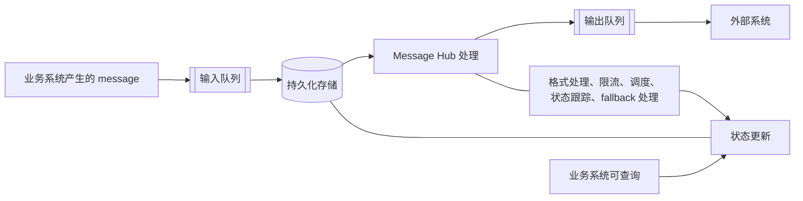

# 问题理解

这个问题的核心是设计一个基础的Message Hub模块，供不同的业务模块调用，并把关键事件的消息分发给外部/第三方服务

业务系统A/B/C  --->  Message Hub ---> 外部系统X/Y/Z

可以解决的问题：
1. 各个业务系统不必重复建设基础设施
2. 统一的消息处理，可以集中对事件进行存储、队列化处理、保障可达性以及监控，并且为其他业务提供支撑
3. 独立的模块可以更好的进行弹性伸缩、扩容，应对变化的业务增长


# 整体架构与核心设计




# 关键工程决策与取舍说明

1. **该系统的定位** 业务系统自己拼好完整的 URL、Header、Body，服务只做透传？还是服务按"供应商模板"做转换，业务方只传事件数据？
> 做一个Message Hub的基础服务模块，而不是一个简单的“消息转发”服务。应该设计好事件的数据格式，在这个中转层做好数据的统一处理、状态管理、存储、可观测性等运维操作。

2. **技术方案选型** 现在有开源的Outpost、Svix server等方案，根据这些方案进行二次开发，还是自己使用关键组件（数据库、MQ）搭建？
> 根据需求讨论的结果，对开源方案进行全面的评测，包括对现有业务的满足程度，二次开发的难度、可维护性等，再进行决策。最终决策自研。

3. **技术栈** 倾向 Go、Java 还是其他？
> 先调研，考虑当下流行的部署形态，优先选择go, rust等编译型、单体二进制语言。以上观点供参考，让AI模型从性能、可维护性、开发速度等维度，结合业务进行洞察和分析。最终选型golang。可以保证较好的性能、较快的开发进度（主要是人类审核）、方便云原生部署、生态完善。

4. **API Key等敏感信息的存储** 
> 先支持K8S Secret，结合K8S体系保障一定的安全性。但是为接入Vault、云服务Secret manager做设计上的冗余。

5. **数据转换处理** 是否使用模板引擎、JSONata/JMESPath 这类 DSL、还是脚本？脚本最灵活，但需要沙箱，安全风险也高
> 不采用，前期先定义好数据格式、字段和功能，后续有实际业务需求时，经过讨论再确定是否引入、引入什么方案


# 如何运行与测试

```bash
make test               # 单元测试（不需要 Docker）
make test-integration   # 含集成与端到端测试（需要 Docker）
make demo               # 本地一键演示：PostgreSQL + 模拟供应商 + Hub，提交事件并展示成功 / 重试 / 死信 / 重放
```

前置条件、Colima 与代理设置、手工调用 API 的步骤见 [`docs/testing/local-testing.md`](docs/testing/local-testing.md)。


# AI对话记录
在根目录`dialogs_with_ai.txt.zip`文件
